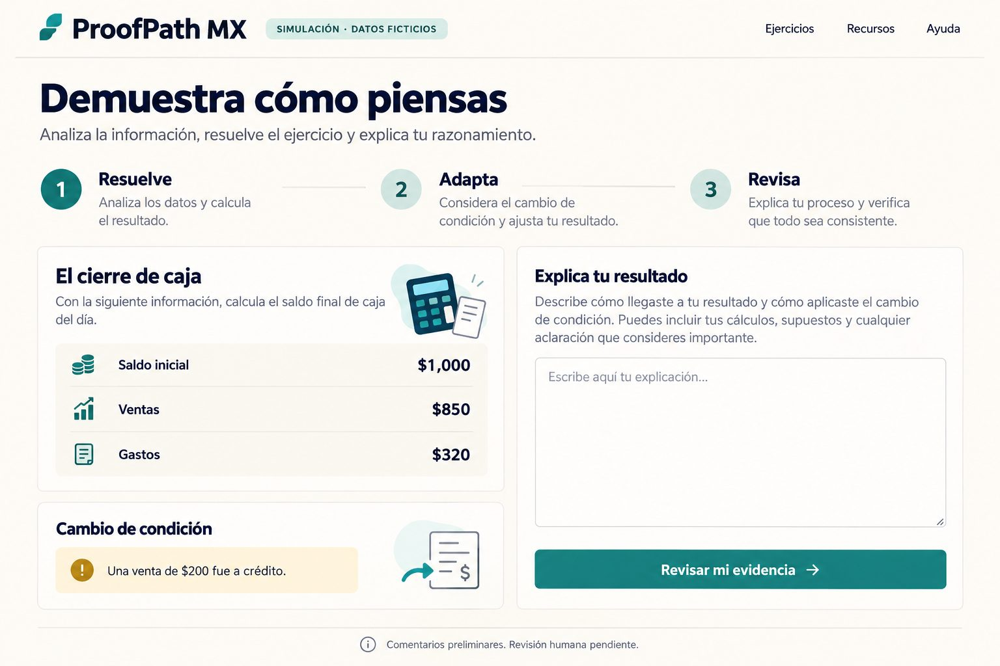
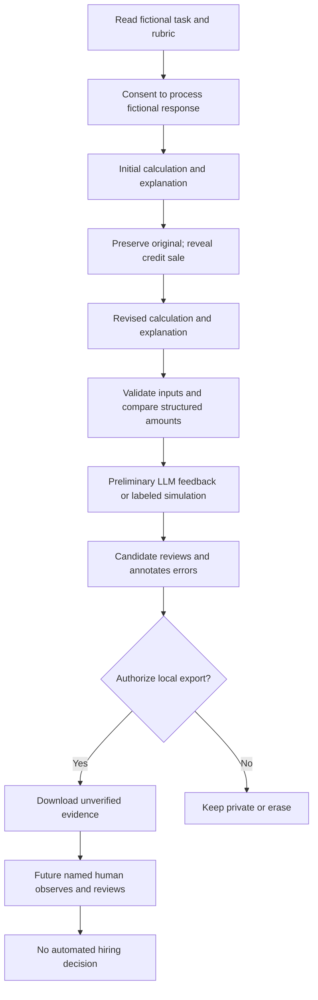
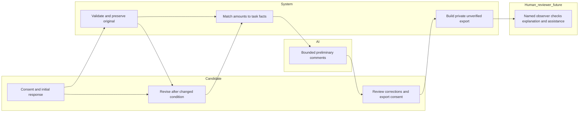

# ProofPath MX — Week 9 Packet

Emiliano Carballido · Team 2 · ADVERSARY · 11 October 2026

Prepared before application code. Source: Week 9 Crystal Ball Brief and BLUEPRINT_Team2_Week9.pdf, recovered from the referenced conversation. The blueprint is a draft from four role briefs; proposed bets, declarations and dissent are not a confirmed team agreement.

## Problem and exact user

FIRST-PROOF: informal capability is often invisible to formal employers. Our user is a 20-year-old Mexican first-job candidate who has helped with a family shop's cash records but has no formal employment history. A polished AI-written answer alone does not show whether that person can explain and adapt their work. The briefing's macroeconomic figures are background claims supplied by the course, not independently verified product inputs; this slice depends only on fictional, checkable arithmetic.

## Success before the module closes

One candidate can solve a fictional cash-close task, preserve an initial response, revise it after a changed condition, inspect preliminary feedback against a public rubric, annotate errors, and voluntarily export an explicitly unverified evidence record. No hiring verdict is produced. A named human must observe/explain and review any future verified proof; this demo does not authenticate reviewers or issue verified credentials.

## Mockup (image-generated before code)

Generated with the built-in image-generation tool. Prompt: “Use case: ui-mockup. Generate one high fidelity desktop web application mockup for ProofPath MX, a Spanish-language fictional bookkeeping work-sample prototype. Warm cream background, dark navy text, teal buttons, simple accessible typography. Header ProofPath MX; small badge SIMULACIÓN · DATOS FICTICIOS. Title Demuestra cómo piensas. Three steps 1 Resuelve, 2 Adapta, 3 Revisa. Main card El cierre de caja shows Saldo inicial $1,000, Ventas $850, Gastos $320. Beside it a textarea Explica tu resultado. Lower small card Cambio de condición with Una venta de $200 fue a crédito. Button Revisar mi evidencia. Footer note Comentarios preliminares. Revisión humana pendiente. No score, ranking, job listings or certification. Flat front-facing UI screenshot, no device frame. This is a planning mockup, not a working screen.”

Implementation may simplify the illustrative navigation. No extra pages are required.

## Bounded task and rubric

Fictional shop: initial cash MXN 1,000 + recorded cash sales 850 - paid expenses 320 = 1,530. After the initial answer is recorded, reveal that 200 of sales were on credit, not received in cash: revised cash = 1,330. Explain the difference and request/check the sales record. Do not assess spelling, prestige, identity or employability.

| Criterion | Evidence sought | Boundary |
| --- | --- | --- |
| Arithmetic | Initial cash calculation | Exact deterministic comparison, not a skill score |
| Adaptation | Revised cash excludes credit sale | Changed-condition response preserved |
| Explanation | Why credit is not cash; what document to check | Preliminary LLM feedback; human interpretation required |
| Ownership | Disclosed AI assistance and candidate correction | No identity or authorship verification claim |

## Flowchart

## Swimlane

## Benchmark

The best existing solution for this slice, as our selected benchmark rather than an exhaustive market ranking, is Forage: its free self-paced employer-designed job simulations let learners practice tasks and compare model answers (https://www.theforage.com/, checked 11 October 2026).

Mine localizes to one Spanish-language Mexican small-business cash task and emphasizes preserved revision, candidate-controlled export and an explicit human-review boundary; employer trust and superiority over an ordinary work-sample test remain unproven.

## Long view — three sentences

In three years, ProofPath MX could offer a small set of employer-funded, accessible work samples that make informal capability visible. Each evidence record would preserve context, assistance, revision and accountable human review while candidates control every share. Expansion would stop unless employers pay to repeat and the evidence adds value beyond an ordinary work-sample test without exploiting candidates.

## Scope cut and blueprint conditions

One task only. No accounts, database, personal profiles, CV builder, job board, ranking, universal score, rejection, verified badge, employer inbox, payments, real client tasks or production work. No automatic publication or sharing. Responses live in page memory until reset/refresh; a candidate may voluntarily download their own record. Accessible alternative: untimed task, calculator allowed, plain Spanish, keyboard controls, browser dictation or an offline human explanation; observed accommodation is not verified by this prototype.

Shadow clause: no unpaid production work or permanent failure label. Any future real client task requires agreed pay, scope, supervision, acceptance rules and applicable labor protections. Private submissions cannot be reused without candidate permission. Employers/institutions are the proposed payers; candidates pay nothing. MONEY's income concern, OPERATOR's supervision concern, USER's informal-capability concern and ADVERSARY's comparison concern are preserved.

## ADVERSARY stop rules

Pilot proposal, not results: 3 Mexican businesses and 12 candidates. Stop/redesign if fewer than 2 of 3 businesses would pay to repeat, median human review exceeds 10 minutes, or evidence adds no useful information beyond a final artifact/ordinary work sample. Record unknowns as NOT TESTED, never PASS. Immediate stop: real unpaid client work, unauthorized sharing, hiring automation or unverifiable claimed credentials. Demo includes a visible checklist; it does not pretend to run the pilot.

## Architecture and Dragon Stack

| Layer | Minimal implementation | Cost / limits |
| --- | --- | --- |
| Interface | Static HTML/CSS/JavaScript, Spanish | No framework dependency needed |
| Structured data | Versioned fictional task, numeric answer key and rubric | Verified arithmetic, not verified candidate identity |
| Matching / automation | Deterministic amount comparison, step transition and JSON evidence export | Never rank candidates |
| LLM | Server-side Vercel function, Gateway-compatible request with bounded rubric context | Live only with configured access; clear simulated fallback; no paid subscription |
| Hosting | Vercel free-compatible deployment | Exactly two manual deploys; no extra Git-triggered builds |
| Storage | Page memory and optional local download | No server persistence, auth/database outside scope |

## Security floor

No credentials in code/repo. Any future API secret belongs in Vercel environment variables, never browser code. No personal data is requested or stored; fictional inputs only, no analytics or response logs. With no database, Supabase Auth and RLS are not applicable; adding personal persistence requires both before shipping. Validate all fields, types, numeric range and text length in the UI and again at the endpoint. Treat response text as untrusted data, never HTML or executable instructions. Fixed provider URL and prompt boundaries; no tools available to the model. Export must label simulation, unverified identity and pending human review. AI errors fall back visibly rather than fabricate successful model calls.

## Test plan and evidence

Mechanical: valid 1530 → 1330 flow; empty/invalid/overlong inputs; unchanged/wrong revised amount; malicious text rendered as text; export blocked without consent; original/revised answers and assistance included; reset clears state; provider failure labeled; responsive keyboard flow. Record actual observed bugs, fix and redeploy; do not insert an artificial bug to satisfy the rubric.

Persona: fresh synthetic-user context, fictional 20-year-old with informal shop experience, mobile-first, uncomfortable with formal accounting vocabulary. Walk screenshots in sequence, log confusion and quitting points, fix the worst confusion, then verify the fix. This is a synthetic test, not user research or proof of employer demand.

## Exactly five new commits and two deployments

1. Packet, generated mockup and decisions before code.
2. Implementation prompt plus functional challenge/revision UI and structured data.
3. Preliminary feedback endpoint, export/consent and initial verification; deployment 1.
4. Observed mechanical and persona fixes with regression evidence; deployment 2.
5. Final test/deploy evidence, PDF source documents, demo guidance and session close; documentation only, no third deployment.

Initial repository commit is pre-existing and does not count as one of the five project commits. Final PDFs can be delivered locally; full transcript must contain actual messages, never reconstructed dialogue. Demo is 3 minutes plus a 30-second personal reflection, recorded by the student.
